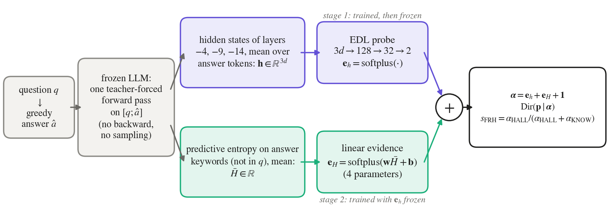

# HEED: Hidden-state and Entropy Evidential Detector

Code for detecting **false recall hallucinations (FRH)** in open-domain QA: the LLM answers a factual
question with a specific but wrong entity. HEED reads two signals from **one teacher-forced forward pass**
of the frozen LLM over the question and its own answer. It needs no backward pass and no extra sampling.



| | |
|---|---|
| **h** | hidden states of decoder blocks −4, −9, −14, each averaged over the answer tokens, concatenated (3d) |
| **H̄** | mean next-token predictive entropy over the answer *keywords*: content words not copied from the question; at most 12, those with the smallest teacher-forced margin |
| **e_h** | evidential MLP (3d → 128 → 32 → 2, LayerNorm, GELU, dropout 0.4, softplus) on the train-standardised h |
| **e_H** | `softplus(w · z(H̄) + b)` with w, b ∈ R² (4 parameters) |
| **output** | α = e_h + e_H + 1 (Dirichlet over {KNOW, HALL}); `s_FRH = α_HALL / (α_HALL + α_KNOW)` |

**Training** has two stages:
1. Train e_h with the class-weighted EDL loss: digamma expected cross-entropy plus a KL term to Dir(1), with λ_KL = 0.01 annealed over 20 epochs.
2. Freeze e_h and train e_H on the summed evidence with the same loss.

All hyper-parameters are shared by the 24 settings ([heed/config.py](heed/config.py)). The validation split is used only for early stopping.

## Results (6 LLMs × 4 datasets, seeds 42–46, stratified 70/15/15 splits, class-balanced)

Positive class is HALL. Each setting is first averaged over its 5 seeds; the table reports the mean over the 24 settings. ± is the standard deviation, over seeds, of the 24-setting average.

| Method | AUROC | AUPR | FPR@95 ↓ |
|---|---|---|---|
| **HEED (e_h + e_H)** | **0.8447 ± 0.0053** | **0.8432 ± 0.0052** | **0.6079 ± 0.0194** |
| e_h only | 0.8390 ± 0.0052 | 0.8400 ± 0.0042 | 0.6306 ± 0.0174 |
| e_H only | 0.7218 ± 0.0048 | 0.7218 ± 0.0053 | 0.8032 ± 0.0098 |
| SAPLMA (faithful re-implementation) | 0.8242 ± 0.0020 | 0.8205 ± 0.0024 | 0.6583 ± 0.0118 |
| LR probe | 0.7679 ± 0.0031 | 0.7612 ± 0.0034 | 0.7594 ± 0.0031 |
| Entropy | 0.7236 ± 0.0011 | 0.7229 ± 0.0017 | 0.7923 ± 0.0059 |
| Perplexity | 0.7123 ± 0.0012 | 0.7105 ± 0.0016 | 0.8058 ± 0.0044 |
| EigenScore | 0.7112 ± 0.0039 | 0.7022 ± 0.0033 | 0.8644 ± 0.0161 |
| MSP | 0.6997 ± 0.0014 | 0.6875 ± 0.0026 | 0.8076 ± 0.0064 |
| PSA | 0.6914 ± 0.0038 | 0.6763 ± 0.0040 | 0.9119 ± 0.0143 |
| CoE-C | 0.5935 ± 0.0024 | 0.5875 ± 0.0023 | 0.9021 ± 0.0042 |
| CoE-R | 0.5930 ± 0.0015 | 0.5818 ± 0.0033 | 0.9038 ± 0.0046 |

`scripts/summarize.py` writes these tables, plus per-dataset and per-setting versions, to `outputs/tables/`.

## Layout

```
heed/                    library
  config.py              experiment grid, paths, hyper-parameters
  data.py                feature access, 70/15/15 splits, train-only standardisation
  model.py               EDL loss, e_h MLP, e_H head, two-stage training
  detector.py            HEEDDetector: load a checkpoint and score (h, H-bar)
  extraction.py          generation, teacher-forced pass, h, H-bar, baseline features
  qa.py                  answer parsing and the KNOW / HALL labelling rule
  metrics.py             AUROC, AUPR, FPR@95
scripts/
  prepare_datasets.py    PopQA, WebQuestions, TriviaQA, MKQA -> data/
  extract_features.py    one LLM x one dataset -> features/<dataset>_<model>.pt
  balance_features.py    KNOW:HALL = 1:1 -> features/<dataset>_<model>_balanced.pt
  train_heed.py          HEED and the e_h-only / e_H-only ablations -> outputs/scores, outputs/checkpoints
  run_baselines.py       MSP, perplexity, entropy, H-bar, CoE-R/C, PSA, EigenScore, LR probe, SAPLMA
  summarize.py           tables
analysis/                paper analyses (relative factual support, support-deficient region, HALL
                         characterisation, k-robustness, latent-support intervention + Cohen's d,
                         score analysis, timing, pipeline figure)
run_all.sh               end-to-end reproduction
```

## Reproduce

```bash
pip install -r requirements.txt
bash run_all.sh
```

To run step by step:

```bash
python scripts/prepare_datasets.py
python scripts/extract_features.py --dataset popqa --model llama2_7b_chat   # --model-path for a local copy
python scripts/balance_features.py --dataset popqa --model llama2_7b_chat
python scripts/train_heed.py --jobs popqa/llama2_7b_chat/42                 # or no --jobs for all 120 runs
python scripts/run_baselines.py
python scripts/summarize.py
```

**Paths.** By default the scripts use `data/`, `features/`, `outputs/` and `figures/`. You can change them with `HEED_DATA_DIR`, `HEED_FEATURE_DIR`, `HEED_OUTPUT_DIR` and `HEED_FIGURE_DIR`.

**Models.** They are loaded by their Hugging Face ids, listed in [heed/config.py](heed/config.py). Llama and Gemma are gated, so you must accept their licences on the Hub first.

**Cost.** Feature extraction is the expensive step. Each question needs one greedy answer and one teacher-forced pass. By default, 5 additional sampled answers are also generated, but only the PSA and EigenScore baselines use them; skip them with `--baseline-samples 0`. Training HEED takes a few seconds per run on a single GPU.

**Exactness.** We re-ran the released code against the feature files used for the paper:
- `scripts/train_heed.py` reproduces the paper's HEED, e_h-only and e_H-only test scores exactly, in all 120 runs.
- `scripts/run_baselines.py` reproduces the training-free baselines and SAPLMA (including the selected layer) exactly. The LR probe matches to within 7e-4 AUROC per run, because multithreaded BLAS changes the lbfgs round-off.
- `scripts/balance_features.py` reproduces the balanced files row for row.
- `scripts/extract_features.py` reproduces generations, labels, h and H̄ bit-for-bit (checked on Llama-2-7B-Chat / PopQA).

Two caveats:
- The answers sampled for the PSA and EigenScore baselines were not seeded in the original runs, so re-extracting gives slightly different values for those two baselines.
- Results on other GPUs or library versions can differ in the last digits.

## Using a trained detector

```python
from heed.detector import HEEDDetector
det = HEEDDetector.load("outputs/checkpoints/heed_popqa_llama2_7b_chat_s42.pt")
s_frh = det.score(h, hbar)   # h: N x 3d (blocks -4, -9, -14, answer-token mean); hbar: N
```

`heed.extraction.extract_example` computes `h`, given as `probe_target_hidden_mean_answer`, and `H̄`, given as `scalar_features[:, "mean_entropy"]`, for one prompt/answer pair.

## Labels

- **KNOW**: a normalised gold alias appears in the normalised answer. PopQA uses strict substring matching.
- **WebQuestions, TriviaQA and MKQA** also accept article-free matches, generated spans contained in a gold alias, and high token recall for short answers (`heed/qa.py`).
- **HALL**: every other non-empty answer.

## License

MIT for the code. The datasets and models are covered by their own licences.
